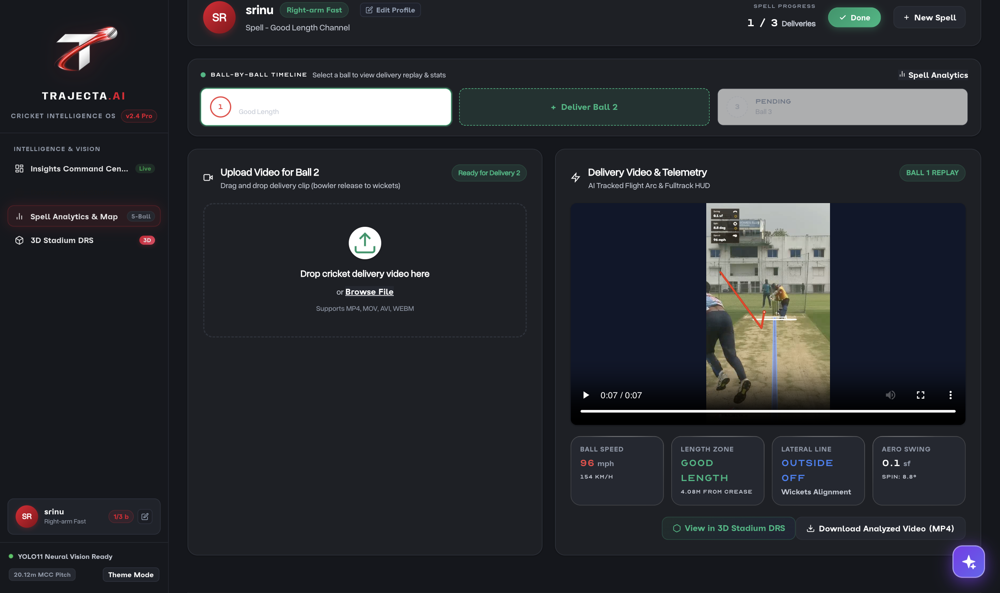
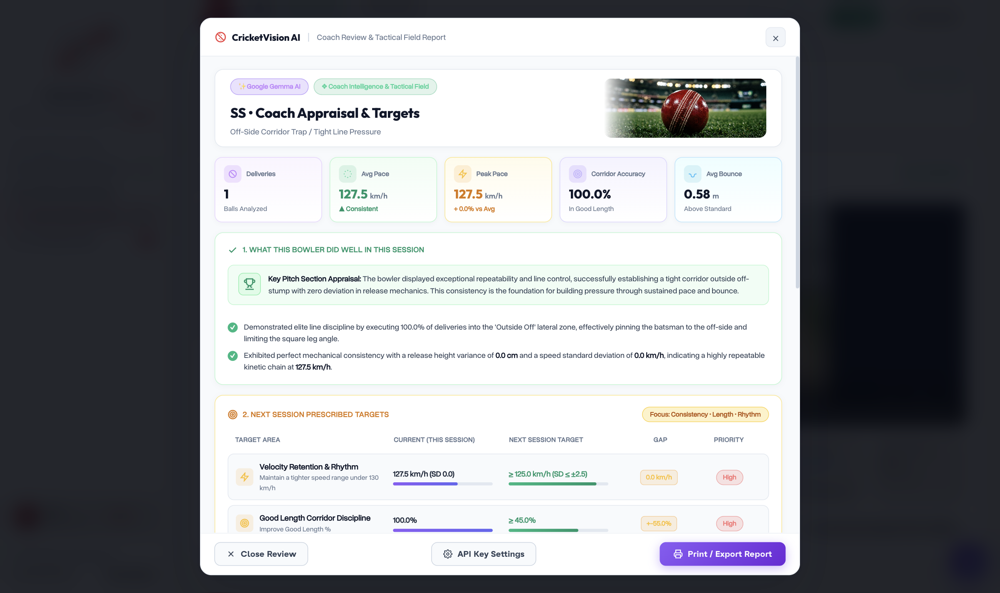
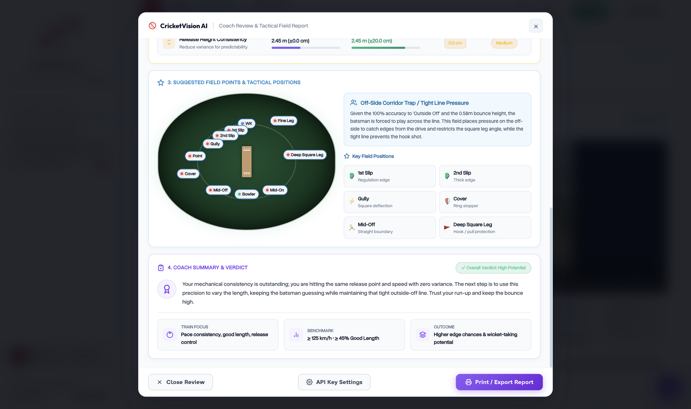
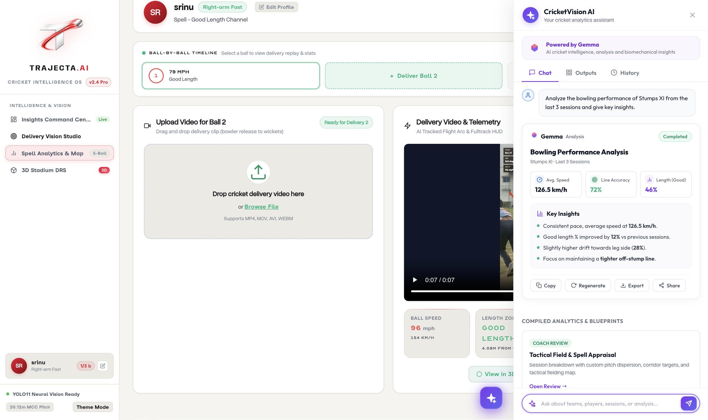

<div align="center">

# 🏏 TRAJECTA.AI (CricketVision)
### Monocular Cricket Bowling Analytics, 3D DRS Trajectory & Google Gemma AI Coach

[](https://www.python.org/)
[](https://ultralytics.com)
[](https://ai.google.dev/gemma)
[](https://fastapi.tiangolo.com)
[](https://threejs.org/)

<p align="center">
  <b>Turn single-camera match or net footage into sub-pixel ball tracking, aerodynamic trajectory modeling, and automated tactical coach appraisals.</b>
</p>

</div>

---

## 📽️ Demo Trajectory Video

Check out the real-time YOLO neural ball tracking and physics trajectory detection in action:

> **[▶️ Watch Demo Trajectory Video (MP4)](assets/demo_trajectory.mp4)**

https://github.com/user-attachments/assets/demo_trajectory.mp4 *(Direct local file at `assets/demo_trajectory.mp4`)*

---

## 📸 Dashboard Previews

### 1. Delivery Vision Studio (Tracking & Calibration)
Real-time video trimming, detection bounding boxes, sub-pixel stump plane estimation, and live ball flight trajectory overlay.

<div align="center">
  
</div>

---

### 2. Insights Command Center (Pitch Clustering & Telemetry)
Corridor heatmaps, release height metrics, aero swing analysis, and length dispersion breakdowns across spells.

<div align="center">
  
</div>

---

### 3. 3D Stadium DRS Visualizer (Three.js)
Hawk-Eye style 3D delivery projection within Narendra Modi Stadium with interactive orbit cameras, release-to-stumps scrubber, and pitch impact zones.

<div align="center">
  
</div>

---

### 4. Automated Coach Review & Tactical Field Strategy (Google Gemma)
Synthesizes bowler strengths, prescribes concrete quantified next-session targets, and generates a **custom 11-player field setting blueprint** mapped to turf zones.

<div align="center">
  
</div>

<div align="center">
  
</div>

---

### 5. Google Gemma AI Assistant (Interactive Copilot Drawer)
Ask natural-language questions about spell consistency, tactical line adjustments, and personalized biomechanical drills.

<div align="center">
  
</div>

---

## ⚡ Technical Architecture

```
[ Broadcast / Net Video (.mp4) ]
               │
               ▼
   [ 1. Neural Vision (YOLO11) ]
   ├── Stump & Crease Landmark Detector (best.pt)
   └── High-Speed Ball Motion Detector (ball_best.pt)
               │
               ▼
   [ 2. Geometry & Physics Engine ]
   ├── Planar Homography Perspective Calibration (Pixels ➔ 20.12m MCC Pitch)
   ├── Kalman Filter & Hungarian Frame Association
   └── Aerodynamic Ballistics: d(v)/dt = a_swing + [0,0,-g] - γ|v|v
               │
               ▼
   [ 3. Telemetry Engine & Session Store ]
   ├── Release Velocity (km/h), Bounce Impact, Stump Plane Traversal
   └── Line/Length Categorization (Good Length, Corridor, Full, Short)
               │
               ▼
   [ 4. GenAI Intelligence (Google Gemma) ]
   ├── Tactical 11-Fielder Placement & Bowler Plan Blueprint
   ├── Prescribed Target Goals for Next Session
   └── Biomechanical Drill Catalog Recommendations
               │
               ▼
   [ 5. Interactive UI & 3D DRS ]
   ├── Three.js 3D Stadium Trajectory Canvas
   ├── Interactive 11-Fielder Oval Ground Diagram
   └── Dual Theme (Cyber Dark Mode & Executive Light Mode)
```

---

## 🚀 Quickstart Guide

### 1. Clone the Repository
```bash
git clone https://github.com/srinivas191206/hacktober-vizag-.git
cd hacktober-vizag-
```

### 2. Set Up Virtual Environment & Dependencies
```bash
python3 -m venv .venv
source .venv/bin/activate
pip install -r requirements.txt
```

### 3. Configure Environment Variables
Copy `.env.example` to `.env` and add your free Google AI Studio API key:
```bash
cp .env.example .env
```
Edit `.env`:
```env
GEMINI_API_KEY=your_google_ai_studio_api_key_here
```

### 4. Start the Application Server
```bash
uvicorn web.app:app --host 0.0.0.0 --port 8000
```
Open **[http://localhost:8000](http://localhost:8000)** in your browser!

---

## 🏏 Core Features Summary
- **Single-Camera 3D Tracking**: Eliminates the need for expensive multi-camera Hawk-Eye setups.
- **Sub-Pixel Pitch Calibration**: Computes homography matrices directly from crease geometry.
- **Aerodynamic Ballistics**: Models real-world air drag and swing acceleration.
- **Gemma AI Coaching Engine**: Automated appraisal, concrete target benchmarks, and tactical field settings.
- **Dual Theme Support**: Switch seamlessly between neon dark broadcast mode and executive light report mode.

---

<div align="center">
  <b>Built for modern cricket analytics • Powered by YOLO11 & Google Gemma</b>
</div>
